  

## Sameer Alam

**Infrastructure Reliability & Security Engineer** · 8 years

I build tools that detect, diagnose, and safely fix production failures across Kubernetes clusters and Linux fleets.

[Portfolio](https://sameeralam3127.github.io/) · [Compute Central](https://computecentral.in/) ·  [Linux Vitals](https://sameeralam3127.github.io/linux-vitals/) · [IPMG](https://sameeralam3127.github.io/ipmg/)
<!-- TODO: LinkedIn URL — add " · [LinkedIn](https://www.linkedin.com/in/<handle>/)" to the line above -->

## What I build

| Project | Problem it solves | Links |
| --- | --- | --- |
| **Linux Vitals** (Ansible) | Health-checking a mixed RHEL, Ubuntu, and SUSE fleet without installing agents. Compares baseline to post-change state, writes one HTML report, and only fixes things when you opt in. | [Live](https://sameeralam3127.github.io/linux-vitals/) · [Repo](https://github.com/sameeralam3127/linux-vitals) · [Galaxy](https://galaxy.ansible.com/ui/repo/published/sameeralam3127/linux_vitals/) |
| **IPMG** (Python) | Finding which hosts went down since the last scan. Parallel ping sweeps, reverse DNS, and scan-to-scan diffs. `brew install sameeralam3127/tap/ipmg` | [Live](https://sameeralam3127.github.io/ipmg/) · [Repo](https://github.com/sameeralam3127/ipmg) |
| **llm-dev-kit** (TypeScript) | Chat and RAG over private PDFs without data leaving the machine: local-first on Ollama, with optional cloud model routing. | [Repo](https://github.com/sameeralam3127/llm-dev-kit) |

## Live tool status

Checked every 6 hours by a [GitHub Actions workflow](.github/workflows/status.yml).

<!-- STATUS:START -->
<!-- status-state: {"checked": "2026-11-09 06:22", "up": {"IPMG": true, "Linux Vitals": true}} -->
| Tool | Status | Response ms | Last checked (UTC) |
| --- | --- | --- | --- |
| [IPMG](https://sameeralam3127.github.io/ipmg/) | 🟢 Up | 115 | 2026-11-09 06:22 |
| [Linux Vitals](https://sameeralam3127.github.io/linux-vitals/) | 🟢 Up | 108 | 2026-11-09 06:22 |
<!-- STATUS:END -->

## Upstream contributions

- **docling-project/docling-pipelines** — refactor(ollama): hoist repeated imports out of OllamaClient hot-path methods ([#133](https://github.com/docling-project/docling-pipelines/pull/133))
- **mloda-ai/mloda** — docs: note that new doc py fences may need an allowlist bump ([#1443](https://github.com/mloda-ai/mloda/pull/1443))
- **ansible/ansible-lint** — fix: add validate_argspec to play schema ([#5187](https://github.com/ansible/ansible-lint/pull/5187))
- **ansible-community/awesome-ansible** — Add Ansible Tutorial by Compute Central to Tutorials section ([#112](https://github.com/ansible-community/awesome-ansible/pull/112))

---

Happy to talk about reliability, Kubernetes, Linux automation, and infrastructure security.
